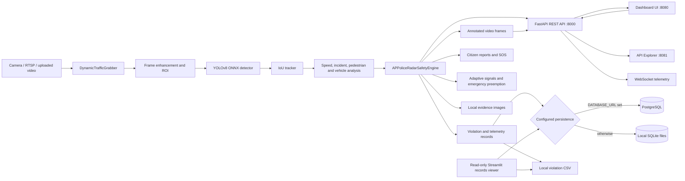

# System architecture

This document describes the code currently in the repository. It distinguishes
implemented local features from external services that are simulated or require
separate configuration.

## System context

The main process starts three ASGI applications: the REST API, a web dashboard,
and the API Explorer. The latter two are served by auxiliary Uvicorn threads;
the REST API owns the application lifespan and traffic pipeline. A separate
Streamlit records viewer can be started independently.

## Runtime request and video flow

1. `src/main.py` reads `.env`, validates the optional PostgreSQL URL, and
   initializes the configured persistence backend.
2. The traffic capture worker reads the selected camera, RTSP source, or video
   file. With no active source, the application can display its built-in
   simulator.
3. The inference worker enhances each frame, applies the configured region of
   interest, and invokes `ONNXObjectDetector` in `src/onnx_detector.py`.
4. The detector letterboxes RGB input, runs the local YOLOv8 ONNX model with
   ONNX Runtime, decodes detections, and applies class-aware non-maximum
   suppression. Large frames receive a full-frame pass and overlapping crop
   passes; detections are merged and deduplicated.
5. `IoUTracker` assigns simple class-aware track IDs. The safety engine uses
   those IDs to update trajectories, line-crossing timing, speed estimates,
   risk calculations, and annotated detection telemetry.
6. Annotated frames and telemetry are made available to the WebRTC stream,
   REST endpoints, dashboard, and WebSocket clients. Violation records are
   persisted to PostgreSQL when configured and appended to the local CSV.

The detector expects a compatible YOLOv8 **detection** ONNX model at
`assets/models/yolov8n.onnx` unless `YOLO_MODEL_PATH` overrides it. The model
file is local and Git-ignored; model weights and inference behavior should be
validated against representative, labeled traffic footage before operational
use.

## Application components

| Component | Responsibility |
| --- | --- |
| `src/main.py` | FastAPI app lifecycle and endpoints; video source and inference orchestration; traffic, safety, and integration engines; persistence adapter. |
| `src/onnx_detector.py` | ONNX Runtime session, YOLOv8 preprocessing/output decoding, crop inference, class-wise NMS, and IoU tracking. |
| `dashboard/app.py` | Separate read-only Streamlit viewer for violations, registry, citizen reports, telemetry, and blockchain records. Uses PostgreSQL when `DATABASE_URL` is set and the retained SQLite/CSV files otherwise. |
| `scripts/configure_postgres.py` | Interactively provisions a dedicated PostgreSQL role and database, verifies the generated app connection, and saves the URL to ignored `.env`. |
| `scripts/migrate_sqlite_to_postgres.py` | Copies existing SQLite tables and violation CSV rows to PostgreSQL without replacing rows already present. |
| `tests/test_onnx_detector.py` | Unit coverage of YOLO output decoding, NMS, crop layout/merging, model-path errors, and tracking. |

The traffic safety engine also contains modules for adaptive traffic signals,
collision-risk heuristics, weather visibility, emissions estimates, citizen
reports/SOS, vehicle registry lookup, hotlist checks, acoustic analysis, and
emergency-vehicle preemption. Several integrations are local simulations or
sandbox behavior; see the code/configuration before treating a displayed
integration status as a live connection to a government or emergency service.

## Persistence and data layout

The database adapter in `src/main.py` selects PostgreSQL when `DATABASE_URL` is
present and otherwise uses SQLite files below `SQLITE_DATABASE_DIR` (default:
`data/`). PostgreSQL connections use the pure-Python `pg8000` driver.

| Data | PostgreSQL table | SQLite source / fallback |
| --- | --- | --- |
| Challan blockchain blocks | `blockchain_blocks` | `data/challan_blockchain.db` |
| Citizen reports and SOS | `citizen_reports` | `data/citizen_safety.db` |
| Vehicle registry | `vahan_registry` | `data/traffic_registry.db` |
| Highway telemetry | `highway_telemetry` | `data/traffic_timeseries.db` |
| Violation details | `traffic_violations` | `data/traffic_violations_log.csv` |

The migration script retains the SQLite database files and source CSV; it does
not remove, rewrite, or treat them as disposable. Re-running migration skips
rows with keys that already exist. PostgreSQL migrations should be backed up
before execution when the destination already contains important data.

Video uploads and sample videos live in `uploads/videos/`; citizen attachments
are stored in `uploads/citizen_uploads/`; violation evidence images are stored
in `evidence/violations/`; and the ONNX model is stored in `assets/models/`.
These artifacts stay on disk and are intentionally excluded from Git. The
repository includes directory placeholders, not local database contents,
datasets, evidence, credentials, or model weights.

## Service interfaces

The default local ports are configurable from the command line:

| Service | Default | Examples |
| --- | ---: | --- |
| REST API | `8000` | `/api/health`, `/api/system/overview`, `/api/detections`, `/docs` |
| Web dashboard | `8080` | `/` |
| API Explorer | `8081` | `/` |
| WebSocket telemetry | REST API port | `/ws/telemetry` |
| Streamlit records viewer | Streamlit default `8501` | `dashboard/app.py` |

The ports for the three FastAPI applications must be different. API and UI
origins may be set through the dashboard URL/origin environment variables.

## Configuration and startup

1. Install dependencies from `requirements.txt`, create `.env` from
   `.env.example`, and provide a compatible ONNX model locally.
2. For SQLite, leave `DATABASE_URL` unset. For PostgreSQL, run
   `scripts/configure_postgres.py` in a terminal and enter the PostgreSQL
   administrator password at its hidden prompt.
3. If moving existing local records, run
   `scripts/migrate_sqlite_to_postgres.py` after configuring PostgreSQL.
4. Start the main application with `python -m src.main`; start the separate
   records viewer with `python -m streamlit run dashboard/app.py`.

The app does not silently fall back to SQLite if a configured PostgreSQL
connection fails. This avoids reporting successful operation against a
different or empty database.

## Known scope and limitations

- The supplied default model is COCO-trained and is not specifically trained
  on the project's road-camera conditions. Exact screenshot-like detection
  requires the relevant original footage and labeled examples for evaluation
  and, if needed, model fine-tuning.
- Tracking uses IoU association rather than a learned multi-object tracker;
  identities may change during occlusion or abrupt object motion.
- Estimated vehicle speed depends on camera calibration, line placement, and
  measured distance. Detection boxes alone are not a verified speed sensor.
- The Streamlit viewer is read-only. It reads violation details from the CSV in
  SQLite mode and from `traffic_violations` in PostgreSQL mode.
- Camera input, PostgreSQL credentials, model files, videos, and evidence
  snapshots are machine-local runtime configuration/data and are not committed.
