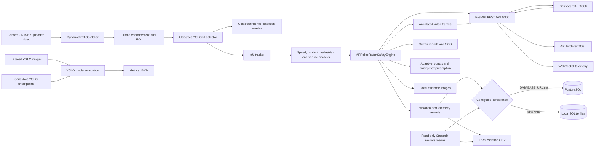

# System architecture

This document describes the code currently in the repository. It distinguishes
implemented local features from external services that are simulated or require
separate configuration.

## System context

The main process starts three ASGI applications: the REST API, a web dashboard,
and the API Explorer. The latter two are served by auxiliary Uvicorn threads;
the REST API owns the application lifespan and traffic pipeline. A separate
Streamlit records viewer can be started independently.

Protected REST endpoints use separate viewer/operator bearer tokens loaded
from the ignored local `.env`; viewer access is read-only and operator access
is required for state-changing API operations. Health and a non-sensitive
prototype overview are public. The telemetry WebSocket requires an initial
token-authentication message and allows setting changes only to operators.
These shared tokens are a local prototype control, not a user-account or
production identity system. The separate Streamlit records viewer also
requires a viewer or operator token before it reads personal records.

## Runtime request and video flow

1. `src/config.py` reads `.env`, validates the optional PostgreSQL URL, and
   initializes the configured persistence backend.
2. The traffic capture worker reads the selected camera, RTSP source, or video
   file. With no active source, the application can display its built-in
   simulator.
3. The inference worker in `src/services/pipeline.py` enhances each frame,
   applies the configured region of interest, and invokes `YOLO26Detector` in
   `src/yolo_detector.py`.
4. The detector runs the Ultralytics YOLO26 checkpoint on CPU. Large frames
   receive a full-frame pass plus overlapping crop passes; detections are
   merged with class-aware non-maximum suppression.
5. `IoUTracker` assigns simple class-aware track IDs. The safety engine uses
   those IDs to update trajectories, line-crossing timing, speed estimates,
   risk calculations, and annotated detection telemetry.
6. Annotated frames and telemetry are made available to the WebRTC stream,
   REST endpoints, dashboard, and WebSocket clients. Violation records are
   persisted to PostgreSQL when configured and appended to the local CSV.

The detector defaults to the COCO-pretrained YOLO26 nano **detection**
checkpoint at `assets/models/yolo26n.pt`; `YOLO_MODEL_PATH` can select another
Ultralytics detection checkpoint. The model file is local and Git-ignored.
Model weights and inference behavior should be validated against
representative, labeled traffic footage before operational use.

## Application components

| Component | Responsibility |
| --- | --- |
| `src/main.py` | FastAPI app lifecycle, endpoint registration, and application startup; retained as the `python -m src.main` entry point. |
| `src/config.py` | Project paths, local environment loading, PostgreSQL/SQLite configuration, and database connection adapter. |
| `src/services/integrations.py` | Traffic-domain engines and their data integrations, including vehicle registry, citizen reports, signals, and telemetry. |
| `src/services/india_vehicle_codes.py` | Local state/union-territory and RTO registration-code identification from `data/india_rto_codes.csv`. |
| `src/services/pipeline.py` | Video capture, YOLO inference orchestration, safety analysis, annotated frames, and WebRTC video track. |
| `src/services/traffic.py` | Compatibility exports for traffic types and services from the specialized modules. |
| `src/web/pages.py` | HTML builders for the browser dashboard and API explorer. |
| `src/yolo_detector.py` | Ultralytics YOLO26 inference, crop inference, class-wise NMS, and IoU tracking. |
| `dashboard/app.py` | Separate read-only Streamlit viewer for violations, registry, citizen reports, telemetry, and blockchain records. Uses PostgreSQL when `DATABASE_URL` is set and the retained SQLite/CSV files otherwise. |
| `scripts/configure_postgres.py` | Interactively provisions a dedicated PostgreSQL role and database, verifies the generated app connection, and saves the URL to ignored `.env`. |
| `scripts/migrate_sqlite_to_postgres.py` | Copies existing SQLite tables and violation CSV rows to PostgreSQL without replacing rows already present. |
| `scripts/prepare_yolo_dataset.py` | Samples video frames into separate train, validation, and test image folders; whole clips are assigned to a split to avoid neighboring-frame leakage. |
| `scripts/annotate_yolo.py` | Creates human-reviewed YOLO-format bounding-box labels with a local OpenCV annotation window. |
| `scripts/evaluate_yolo.py` | Compares Ultralytics YOLO checkpoints on a labeled YOLO-format image split, reporting detection quality and inference latency. |
| `tests/test_yolo_detector.py` | Unit coverage of model inference, NMS, crop layout/merging, and tracking. |
| `tests/test_yolo_evaluation.py` | Tests YOLO label parsing, IoU, and detection metrics. |

The traffic safety engine also contains modules for adaptive traffic signals,
collision-risk heuristics, weather visibility, emissions estimates, citizen
reports/SOS, vehicle registry lookup, hotlist checks, acoustic analysis, and
emergency-vehicle preemption. Several integrations are local simulations or
sandbox behavior; see the code/configuration before treating a displayed
integration status as a live connection to a government or emergency service.
The RTO registry and e-challan flow use local/demo data; SOS records do not
dispatch to emergency services. The signal controller is not connected to
physical traffic lights.

## Persistence and data layout

The database adapter in `src/config.py` selects PostgreSQL when `DATABASE_URL` is
present and otherwise uses SQLite files below `SQLITE_DATABASE_DIR` (default:
`data/`). PostgreSQL connections use the pure-Python `pg8000` driver.

| Data | PostgreSQL table | SQLite source / fallback |
| --- | --- | --- |
| Challan blockchain blocks | `blockchain_blocks` | `data/challan_blockchain.db` |
| Citizen reports and SOS | `citizen_reports` | `data/citizen_safety.db` |
| Vehicle registry | `vahan_registry` | `data/traffic_registry.db` |
| Highway telemetry | `highway_telemetry` | `data/traffic_timeseries.db` |
| Violation details | `traffic_violations` | `data/traffic_violations_log.csv` |

The migration script retains the SQLite database files and source CSV; it does
not remove, rewrite, or treat them as disposable. Re-running migration skips
rows with keys that already exist. PostgreSQL migrations should be backed up
before execution when the destination already contains important data.

The vehicle-code library loads its local RTO directory from
`data/india_rto_codes.csv`; lookups identify registration prefixes and do not
query VAHAN or verify vehicle ownership. Refer to the README for the data
sources and coverage limitations.

Video uploads and sample videos live in `uploads/videos/`; citizen attachments
are stored in `uploads/citizen_uploads/`; violation evidence images are stored
in `evidence/violations/`; and the YOLO26 checkpoint is stored in `assets/models/`.
These artifacts stay on disk and are intentionally excluded from Git. The
repository includes directory placeholders, not local database contents,
datasets, evidence, credentials, or model weights.

The API upload endpoint accepts MP4/AVI/MOV/MKV video only, checks that the
file can be decoded, generates a server-side filename, and limits uploads to
500 MiB. Protected API responses are marked `no-store`; local files and
database contents are not encrypted by the application. Network deployment
requires an HTTPS reverse proxy, private application ports, encrypted storage
and backups, access-controlled host/database accounts, and an approved privacy
and retention policy. The project is not certified for enforcement or
emergency-response use.

## Service interfaces

The default local ports are configurable from the command line:

| Service | Default | Examples |
| --- | ---: | --- |
| REST API | `8000` | `/api/health`, `/api/system/overview`, `/api/detections`, `/docs` |
| Web dashboard | `8080` | `/` |
| API Explorer | `8081` | `/` |
| WebSocket telemetry | REST API port | `/ws/telemetry` |
| Streamlit records viewer | Streamlit default `8501` | `dashboard/app.py` |

The ports for the three FastAPI applications must be different. API and UI
origins may be set through the dashboard URL/origin environment variables.

## Configuration and startup

1. Install dependencies from `requirements.txt`, create `.env` from
   `.env.example`, and download the YOLO26 checkpoint as described in the README.
2. For SQLite, leave `DATABASE_URL` unset. For PostgreSQL, run
   `scripts/configure_postgres.py` in a terminal and enter the PostgreSQL
   administrator password at its hidden prompt.
3. If moving existing local records, run
   `scripts/migrate_sqlite_to_postgres.py` after configuring PostgreSQL.
4. Start the main application with `python -m src.main`; start the separate
   records viewer with `python -m streamlit run dashboard/app.py`.

The app does not silently fall back to SQLite if a configured PostgreSQL
connection fails. This avoids reporting successful operation against a
different or empty database.

## Known scope and limitations

- The supplied default model is COCO-trained and is not specifically trained
  on the project's road-camera conditions. Exact screenshot-like detection
  requires the relevant original footage and labeled examples for evaluation
  and, if needed, model fine-tuning.
- Tracking uses IoU association rather than a learned multi-object tracker;
  identities may change during occlusion or abrupt object motion.
- Estimated vehicle speed depends on camera calibration, line placement, and
  measured distance. Detection boxes alone are not a verified speed sensor.
- The Streamlit viewer is read-only. It reads violation details from the CSV in
  SQLite mode and from `traffic_violations` in PostgreSQL mode.
- Camera input, PostgreSQL credentials, model files, videos, and evidence
  snapshots are machine-local runtime configuration/data and are not committed.
