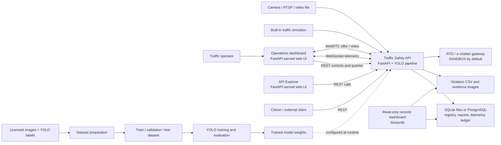
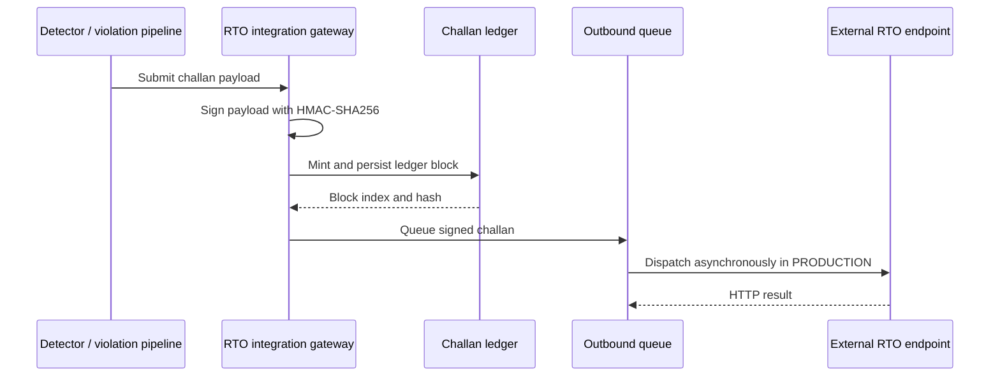

# Traffic Safety System Architecture

## Product scope

The product is a traffic-safety command center for processing a live camera,
video file, RTSP stream, or simulator feed; presenting detection and telemetry
to operators; and providing APIs for traffic operations, citizen reports,
vehicle lookup, and e-challan records. It also includes a separate,
read-only dashboard for reviewing persisted records and a workflow for
preparing and training the vehicle detector.

This document describes the implementation in this repository. The runtime is
a Python application, not a collection of independently deployed services.

## System context

## Runtime components

### Traffic processing

`src/main.py` hosts the runtime pipeline and the HTTP/WebSocket endpoints.
At startup, the FastAPI lifespan:

1. Creates a `DynamicTrafficGrabber` for the selected source. If a usable
   camera/stream source is unavailable, the pipeline can use its simulator.
2. Creates an `APPoliceRadarSafetyEngine` with the configured YOLO model.
   The engine tracks objects and calculates detection and traffic telemetry.
3. Starts the frame grabber, detection engine, acoustic analysis worker, and
   asynchronous RTO dispatch worker.
4. Publishes telemetry to connected WebSocket clients and exposes the latest
   video through WebRTC.
5. Stops workers and closes peer connections during application shutdown.

The detector pipeline combines the YOLO tracker with ROI/preprocessing,
trajectory and collision analysis, plate/vehicle lookup, and violation
processing. Other in-process engines provide:

- Predictive risk and incident alerts, including time-to-collision,
  stalled-vehicle, wrong-way, and overlapping-box checks.
- Adaptive signals and emergency green-corridor preemption.
- HSRP-format checks, vehicle registry resolution, and CCTNS hotlist lookup.
- Citizen hazard reports and SOS events.
- Weather and fleet-emissions analysis.
- Optimization, registry-search, and hazard-classification endpoints grouped
  under the QAOA, Grover, and QSVM module names.

These engines are instantiated inside the main application process. The
quantum-named modules are application modules in this repository; the runtime
does not connect to a separately deployed quantum-computing service.

### HTTP and user interfaces

The process runs three FastAPI applications on separate configurable ports:

| Application | Purpose | Default port |
| --- | --- | ---: |
| Main API | REST API, OpenAPI/Swagger, WebSocket telemetry, and WebRTC signaling | 8000 |
| Operations dashboard | Browser UI for stream controls, live monitoring, and safety operations | 8080 |
| API Explorer | Browser UI generated from the main API's OpenAPI schema | 8081 |

The dashboard and API Explorer are auxiliary FastAPI apps started in server
threads by `src.main`; they call the main API over HTTP. Browser-origin access
is configured with `DASHBOARD_ORIGINS`. The separate `dashboard/app.py`
application is a Streamlit records viewer, started independently, and reads
records without writing them.

The main API includes health and overview, detections, video upload/source
switching, snapshot and violation export, vehicle lookup, traffic-signal
controls, blockchain ledger, citizen report/SOS, HSRP checks, green-corridor
controls, weather/carbon reports, and quantum-named module operations.

## Data and persistence

The application uses a small database adapter to support either SQLite or
PostgreSQL:

- If `DATABASE_URL` is set, runtime database connections use PostgreSQL through
  `psycopg`.
- Otherwise, runtime data is stored in project-relative SQLite files under
  `SQLITE_DATABASE_DIR` (default: `data/`).
- The runtime initializes its application tables when its engines are created.
  PostgreSQL and existing SQLite files are separate data stores; selecting a
  PostgreSQL URL does not migrate/import the SQLite records.

| Data | Default SQLite file | Main owner |
| --- | --- | --- |
| Blockchain-style e-challan blocks | `data/challan_blockchain.db` | `ChallanBlockchainLedger` |
| Citizen safety reports | `data/citizen_safety.db` | `CitizenSafetyPortalEngine` |
| Vehicle registry | `data/traffic_registry.db` | `APVehicleRegistryEngine` |
| Highway telemetry | `data/traffic_timeseries.db` | `TimeSeriesMetricsLogger` |
| Violation export/log | `data/traffic_violations_log.csv` | Traffic processing pipeline |
| Violation snapshots | `evidence/violations/` | Traffic processing pipeline |
| Uploaded videos and citizen media | `uploads/videos/`, `uploads/citizen_uploads/` | Upload/API flows |

The ledger chains records with SHA-256 hashes; it is an application-managed
ledger stored in the configured database, not a connection to a public
blockchain network.

The Streamlit viewer reads the four database tables and violation CSV. It
limits displayed records and uses short-lived caching; it is not part of the
FastAPI lifespan.

## e-Challan dispatch flow

The default gateway mode is `SANDBOX`; it simulates successful dispatch rather
than contacting the external authority. `PRODUCTION` dispatch uses the
configured integration endpoint. Real enforcement or external dispatch should
be enabled only after the endpoint, credentials, operational procedures, and
decision rules have been validated.

## Detector data and model lifecycle

The detector lifecycle is separate from live application startup:

1. Collect/authorize images and create YOLO-format labels.
2. Run `scripts/prepare_dataset.py` to validate annotations and create
   reproducible train/validation/test splits and a dataset YAML file.
3. Run `scripts/train_detector.py` to fine-tune YOLO and evaluate the selected
   validation or test split.
4. Point the runtime `--model` option at the resulting weights.

The trained model provides object detections/tracks. It does not, by itself,
establish that a statutory violation occurred. The project documentation
notes that speed and signal-violation decisions need calibrated tracking and
signal/stop-line logic, and helmet/signal-jumping challan decisions are not
currently driven by trained model detections.

## Configuration and local operation

- `.env` is loaded from the project root; `.env.example` documents local
  settings. Do not commit database credentials.
- `--source` accepts a camera index, RTSP URL, or video path.
- `--model`, `--host`, `--port`, `--dashboard-port`, and
  `--api-interface-port` configure the runtime.
- `--env SANDBOX|PRODUCTION` selects the RTO gateway behavior.
- `DASHBOARD_API_URL`, `DASHBOARD_UI_URL`,
  `DASHBOARD_API_INTERFACE_URL`, and `DASHBOARD_ORIGINS` configure browser/API
  connectivity when components are accessed across hosts.
- Start the Streamlit records viewer separately with
  `streamlit run dashboard/app.py`.

## Repository map

| Path | Responsibility |
| --- | --- |
| `src/main.py` | FastAPI apps, traffic ingestion/detection, in-process engines, storage access, and runtime APIs |
| `src/config.py` | Minimal project-root `.env` loading |
| `dashboard/app.py` | Read-only Streamlit database and violation-log viewer |
| `scripts/prepare_dataset.py` | Annotation validation and dataset splitting |
| `scripts/train_detector.py` | YOLO fine-tuning and evaluation |
| `assets/models/` | Runtime detector weights |
| `data/` | Local database files and violation CSV |
| `uploads/`, `evidence/` | Uploaded media and generated evidence |
| `tests/` | Automated regression tests |
